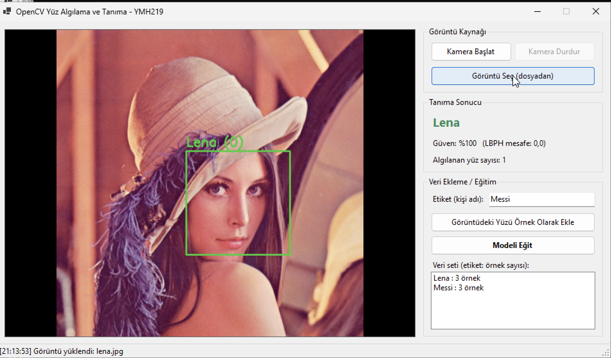

# YMH219 - OpenCV ile Yüz Algılama ve Tanıma

OpenCvSharp kütüphanesi kullanılarak hazırlanan bir Windows Forms uygulaması. Kameradan veya seçilen resimden görüntü alınıyor, yüzler Haar Cascade ile bulunup dikdörtgenle işaretleniyor. Kendi oluşturduğumuz küçük yerel veri setiyle LBPH algoritması eğitilip yüzlerin kime ait olduğu tahmin ediliyor.

**Öğrenci:** Miraç Özcan AĞCABAY - Öğrenci No: 250541002

> **Kapsam:** Bu proje yalnızca ders kapsamında, gönüllü kişilerin (veya kendi yüzümün) örnekleriyle yerel olarak kullanılmak için hazırlandı. Veri seti GitHub'a yüklenmiyor.

## Kullanılan Teknolojiler

- C# / .NET 8 (net8.0-windows), Windows Forms
- NuGet paketleri:
  - `OpenCvSharp4.Windows` 4.10.0.20241108 (OpenCV + Windows native dosyaları)
  - `OpenCvSharp4.Extensions` 4.10.0.20241108 (`Mat` → `Bitmap` dönüşümü)
- Haar Cascade (`haarcascade_frontalface_default.xml`) → yüz algılama
- LBPH (Local Binary Patterns Histograms) → yüz tanıma

## Proje Yapısı

| Dosya | Açıklama |
|---|---|
| `Kamera.cs` | `VideoCapture` ile kamerayı açma, kare okuma, kapatma |
| `YuzAlgilayici.cs` | Cascade dosyasını yükleme, yüzleri bulma, yüzü tanıma için hazırlama (gri, 100x100) |
| `YuzTanimaModeli.cs` | Örnekleri `VeriSeti/<etiket>/` klasörüne kaydetme, LBPH modelini eğitme, tahmin |
| `Form1.cs` | Arayüz, Timer ile kamera döngüsü, sonuçların gösterimi |

## Kurulum ve Çalıştırma

1. Depoyu klonlayın:
   ```bash
   git clone https://github.com/magcabay/YMH219-FaceRecognition.git
   ```
2. `haarcascade_frontalface_default.xml` dosyasının `FaceRecognition/` klasöründe olduğundan emin olun. Yoksa OpenCV'nin resmi deposundan indirin:
   https://github.com/opencv/opencv/blob/4.x/data/haarcascades/haarcascade_frontalface_default.xml
   (Derlemede exe'nin yanına otomatik kopyalanır.)
3. `FaceRecognition.sln` dosyasını Visual Studio 2022 ile açın ve `F5` ile çalıştırın.

## Kullanım

1. **Kamera Başlat** ile kamerayı açın (veya **Görüntü Seç** ile bir resim seçin).
2. Etiket kutusuna kişinin adını yazın (ör. `Ali`) ve **Görüntüdeki Yüzü Örnek Olarak Ekle**'ye birkaç kez basın (farklı açılardan 10-15 örnek iyi sonuç veriyor).
3. En az bir kişi daha için aynı işlemi yapın.
4. **Modeli Eğit**'e basın.
5. Artık yüzlerin üstünde tahmin edilen etiket ve LBPH mesafesi gösterilir. Sağ panelde etiket ve güven yüzdesi yazar.

## Özellikler

- Kamera görüntüsü veya seçilen resim PictureBox'ta gösteriliyor
- Algılanan tüm yüzler dikdörtgenle işaretleniyor (aynı karede birden fazla yüz)
- Tanınan yüz yeşil, tanınmayan yüz kırmızı çerçeve
- Etiket, güven yüzdesi ve LBPH mesafesi arayüzde gösteriliyor
- Basit veri ekleme ekranı: örnekler `VeriSeti/<etiket>/` klasörüne kaydediliyor
- Açılışta kayıtlı veri seti varsa model otomatik eğitiliyor
- Kamera açılamazsa, cascade dosyası yoksa veya resim okunamazsa kullanıcıya hata mesajı veriliyor

## Ekran Görüntüleri




## Bilinen Sınırlamalar / Geliştirme Notları

- LBPH ışık değişimine ve yüz açısına duyarlı; az örnekle yanlış tahmin yapabilir.
- "Bilinmiyor" eşik değeri (80) deneyerek belirlendi, ortama göre değiştirmek gerekebilir.
- OpenCV `PutText` Türkçe karakter gösteremediği için görüntü üzerindeki yazılarda Türkçe harfler sadeleştiriliyor.
- Uygulama sadece varsayılan kamerayı (0 numaralı) kullanıyor.
